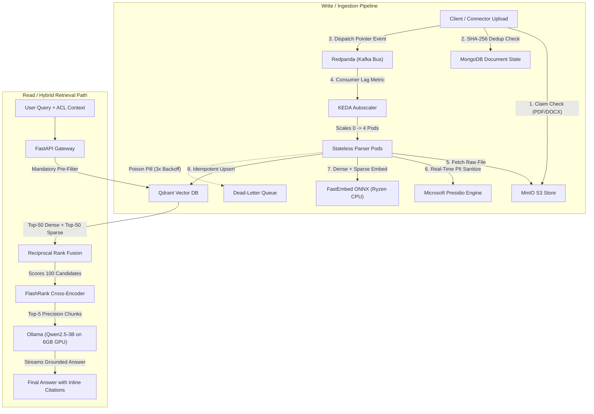

# Architecture Deep-Dive

## 1. System Topology

---

## 2. Hardware Allocation Matrix

| Component | Target Runtime | RAM Allocation | VRAM Allocation |
|---|---|---|---|
| **Redpanda Broker** | C++ Container | ~512 MB | 0 MB |
| **MinIO Storage** | Go Container | ~256 MB | 0 MB |
| **MongoDB** | C++ Container | ~1024 MB | 0 MB |
| **Qdrant Vector DB** | Rust Container | ~1536 MB | 0 MB |
| **KEDA Parser Pods** | Python 3.11 (0 to 4 replicas) | ~2048 MB | 0 MB |
| **FastEmbed (Dense + BM25)** | ONNX Runtime (CPU SIMD) | ~300 MB | 0 MB |
| **FlashRank Cross-Encoder** | ONNX Runtime (CPU) | ~150 MB | 0 MB |
| **Retrieval Gateway & UI** | FastAPI + Uvicorn | ~1024 MB | 0 MB |
| **Ollama LLM Server** | C++ / CUDA | ~500 MB | **~1900 MB (Model) + ~1200 MB (KV Cache)** |
| **Total System Footprint** | | **~7.5 GB / 32 GB RAM** | **~3.5 GB / 6.0 GB VRAM** |

---

## 3. High-Throughput Ingestion Mechanics

1. **Claim-Check Pattern:**  
   Raw binary files are never passed across Kafka messages. Instead, the raw document is uploaded directly to MinIO, and a lightweight JSON payload containing the bucket, object key, SHA-256 hash, and tenant ACLs is published to Redpanda.
2. **Deduplication Fast Lane:**  
   MongoDB checks the SHA-256 hash before Kafka dispatch. If an identical file already exists for that tenant, only ACL permissions are updated, completely bypassing redundant text extraction, chunking, and vector embedding.
3. **KEDA Dynamic Scaling:**  
   KEDA polls Redpanda every 10 seconds. When consumer lag on `doc-ingest-realtime` exceeds 5 messages, KEDA scales parser pods from 0 up to 4 replicas. When the queue is drained, pods scale back to 0 to conserve CPU and RAM.
4. **Resilience & DLQ:**  
   Corrupt or unreadable files retry 3 times with exponential backoff before being forwarded to `doc-ingest-dlq`. The Kafka partition is never blocked.
